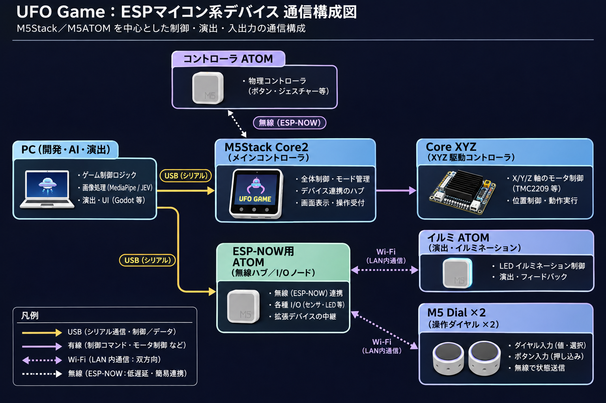

# UFO-DeviceHub

UFO Game の ESP マイコン系デバイス（Hub、Illumination、M5Dial ×2）の通信システム。
共通プロトコル、4 種類のファームウェア、PC 用 Python ライブラリ、Mock、テストを 1 つのプロジェクトで管理する。
**同じ会場で 2 システムを同時に運用できる**（チャネル・鍵・MAC 表・パケット magic をシステムごとに分離。[docs/multi-system.md](docs/multi-system.md)）。

## システム全体の通信構成



| 機器 | 役割 | 接続 |
|---|---|---|
| PC（開発・AI・演出） | ゲーム制御ロジック、画像処理（MediaPipe / JEV）、演出・UI（Godot 等） | Core2 と ESP-NOW 用 ATOM にそれぞれ USB シリアル |
| M5Stack Core2（メインコントローラ） | 全体制御・モード管理、画面表示・操作受付 | PC から USB、Core XYZ へ有線 |
| Core XYZ（XYZ 駆動コントローラ） | X/Y/Z 軸のモータ制御（TMC2209 等）、位置制御 | Core2 から有線 |
| コントローラ ATOM | 物理コントローラ（ボタン・ジェスチャー等） | Core2 と ESP-NOW |
| **ESP-NOW 用ハブ（M5AtomS3R）** | 子機との無線連携、中継。画面にシステム番号・チャネル・接続状態を表示 | PC から USB、子機と無線 |
| **イルミ ATOM** | WS2811 テープ + COB テープの照明演出、ミスト（噴霧）モジュール、本体ボタンでのローカル演出 | ハブと無線 |
| **M5Dial ×2** | ボール受取スイッチ、SG90 によるボール排出、状態表示 | ハブと無線 |
| **スタッフ用リモコン（M5StopWatch）** | 展示スタッフの手元の操作: ゲームのスタッフ操作（つぎへ・とばす・メニュー・ふっき・きりかえ・ストップ）と、カメラを使わない操作（ボタン + 傾きで移動、つかむ・はなす・ポータル） | ハブと無線 |

**このリポジトリが扱うのは太字の機器（ESP-NOW 用 ATOM ハブ、イルミ ATOM、M5Dial ×2、スタッフ用リモコン）と、PC 側のクライアントライブラリ。**
Core2・Core XYZ・コントローラ ATOM は 別リポジトリ（CoreXY_UFO / CoreXY_UFO_Game）で扱う。

図ではハブと子機の間が「Wi-Fi（LAN 内通信）」と描かれているが、実装は AP に接続しない **ESP-NOW の暗号化ユニキャスト（固定チャネル）**。

```
PC (pc/DeviceGateway) --USB JSON Lines--> Hub (M5AtomS3R) --ESP-NOW 暗号化ユニキャスト--> Illumination ATOM / M5Dial #1 / M5Dial #2
```

* ゲームロジックは PC のみ。Hub は中継・再送・セッション・死活監視、子機は I/O とフェイルセーフだけ。
* 詳細: [docs/multi-system.md](docs/multi-system.md)（2 システム運用・混信対策）, [docs/protocol.md](docs/protocol.md)（プロトコル・API）, [docs/game-mode-interface.md](docs/game-mode-interface.md)（ゲームモード: 左右 Dial の LED 演出・排出同期の契約）, [docs/architecture.md](docs/architecture.md), [docs/hardware.md](docs/hardware.md)（ピン・角度・安全仕様）, [docs/test-plan.md](docs/test-plan.md)（自動テストと実機確認手順）

## 同じ会場で 2 システムを動かす（混信対策）

| 層 | システム 1 | システム 2 |
|---|---|---|
| 2.4GHz チャネル（既定） | 1 | 11 |
| MAC 許可リスト | `UFO_S1_MAC_*` | `UFO_S2_MAC_*` |
| ESP-NOW 鍵 | `UFO_S1_PMK/LMK_*` | `UFO_S2_PMK/LMK_*` |
| パケット magic | `0x5546` | `0x5547` |
| PC 側 | `DeviceGateway(system_id=1)` | `DeviceGateway(system_id=2)` |
| PlatformIO env | `*_s1` | `*_s2` |

* 他システムのフレームは「MAC 不一致 → 復号失敗 → magic 不一致」のいずれかで必ず捨てられる。設定を取り違えても、別システムの機器は動かない。
* 起動時に両システムの設定を照合する。MAC や鍵の共有、範囲外のチャネルがあれば **無線を起動せず**、Hub の画面とログに表示する。チャネルが同じ、または近い場合は警告を出す。
* `HELLO` に `system_id` を付けると、別システムの Hub は `SYSTEM_MISMATCH` を返してセッションを張らない（USB の挿し間違いを防ぐ）。

詳細と現地での確認手順: [docs/multi-system.md](docs/multi-system.md)

## セットアップ

```sh
cp config/devices.example.h  config/devices.h     # 両システムの MAC とチャネル（1 ファイルに両方書く）
cp config/hardware.example.h config/hardware.h    # ピン・リレー極性・サーボ角度
python3 tests/tools/gen_secrets.py                # config/secrets.h（システムごとの ESP-NOW 鍵。足りない分だけ追記）
```

`config/devices.h`, `hardware.h`, `secrets.h` は git 管理外（鍵を GitHub に載せないため）。
**`devices.h` と `secrets.h` がないと、そのシステムのファームウェアはビルドエラーになる。**
サンプルの MAC・鍵で書き込んだ機器は Hub と通信できず、ずっと offline になるので、ビルドの時点で止めている。
`hardware.h` はなくてもよい（サンプルのピン配置が使われる）。

### 別の PC でビルド・書込みするとき（必ずやること）

`git clone` しただけの PC には `config/devices.h` と `config/secrets.h` がない。次の手順で用意する。

1. **セットアップ済みの PC から 2 ファイルをコピーする**: `config/devices.h` と `config/secrets.h` を、相手 PC の同じ場所（`config/`）に置く。
   * `secrets.h` は暗号鍵。**git に commit しない。GitHub・チャット・メールに貼らない。** USB メモリ や AirDrop など手渡しで渡す。
   * **`gen_secrets.py` を別の PC で実行し直さない。** 別の鍵ができてしまい、その PC で書き込んだ機器は既存の Hub と通信できない。
   * 1 つのファイルに両システム分が入っているので、2 会場とも同じファイルでよい。
2. **ハードウェア設定を使っている場合は `config/hardware.h` も同じくコピーする**（ピン・極性・角度を変えている場合）。
3. **書き込んだら起動ログを確認する**: `pio device monitor -b 115200` で、次の警告が**出ていない**こと。
   * `WARNING: own MAC differs from config/devices.h - the hub will ignore us`
   * `WARNING: EXAMPLE ESP-NOW KEYS IN USE`
4. **Hub 側でも online を確認する**: ブラウザの試験画面（`pc.web_console`）や `ufo_cli.py` で、書き込んだ機器が online になること。

機器を交換した（MAC が変わった）ときは、`config/devices.h` を書き換えたうえで **その機器と Hub の両方** を書き直し、更新した `devices.h` を他の PC にも配る。

ファイルがない PC でコンパイルだけ確認したい場合（書き込みには使わない）:

```sh
PLATFORMIO_BUILD_FLAGS=-DUFO_ALLOW_EXAMPLE_CONFIG pio run
```

## ビルド・書込み

```sh
pio run                                       # 両システム × 4 台（hub_s1 ... m5dial_2_s2。未設定のシステムはエラー）
pio run -e hub_s1          -t upload          # Hub (M5AtomS3R)            システム 1
pio run -e illumination_s1 -t upload          # Illumination ATOM (0x10)  システム 1
pio run -e m5dial_1_s1     -t upload          # M5Dial #1 (0x20)          システム 1
pio run -e m5dial_2_s1     -t upload          # M5Dial #2 (0x21)          システム 1
pio run -e hub_s2          -t upload          # ... システム 2 は _s2
pio run -e staff_remote_s2 -t upload          # スタッフ用リモコン M5StopWatch (0x30)  システム 2（Hub も書き直す）
pio run -e hub_atomlite_s1 -t upload          # Hub を ATOM Lite にする場合（画面なし、状態 LED）
pio run -e noise           -t upload          # 試験用: 他展示を模擬するノイズ送信機
```

### Illumination ATOM（LED + ミスト）

ATOM Lite + Atomic PWM Base + Unit 2Relay。旧 `atom_led_mist` スケッチの機能を illumination ファームウェアに統合した。

| 出力 | ピン | 制御 |
|---|---|---|
| WS2811 テープ（12V, 70 IC） | G21 | `SET_LIGHT_MODE` / `TRIGGER_EFFECT` |
| COB テープ（電球色 12V, PWM） | G22 | モード・演出に連動して明るさが変わる |
| ミストモジュール（Unit 2Relay RELAY-2） | G32 | `SET_MIST`（CONTINUOUS / BREATH 8 秒出す・6 秒休む / PUFF 3 秒出す・9 秒休む、1 回最大 10 分） |
| 本体ボタン | G39 | PC のセッションがないとき: 短押し = 次のシーン、長押し = ミスト ON/OFF。長押しは PC 制御中でもミストを止める |

照明モードに `AURORA, STORM, CAMPFIRE, MIST_GLOW, MAGIC_PUFF, NIGHT` を追加した。詳細は [docs/hardware.md](docs/hardware.md#illumination-atomdevice-id-0x10)。

### M5Dial（ボール受取・排出、NeoGacha ベース）

| 入出力 | ピン | 動作 |
|---|---|---|
| SG90 サーボ | G13（PORT.A） | `RELEASE_BALL` で排出 → 待機位置へ。ゆっくり動かし、止まったらパルスを止める（電源が落ちる対策） |
| NeoPixel リング | G1（PORT.B） | 状態に合わせた演出。サーボ動作中は暗くする |
| 受取スイッチ | G2（PORT.B、LED の隣） | スイッチ ON = ボール投入（`BALL_RECEIVED`）。GND に落とす配線 |
| ダイヤル | — | 回すと**メニュー**、押すと実行: Dial リセット / 電源オフ / 排出動作 / ゲームのリスタート / ゲームの終了（後ろ 2 つはゲームへの依頼 `DIAL_REQUEST`） |
| 本体ボタン | — | 2 秒長押しで**設定モード**: サーボ・LED・スイッチのテスト |

メニュー・設定モードの使い方とサーボの電源対策（配線側の対策を含む）は [docs/hardware.md](docs/hardware.md#設定モードハードウェアテスト)。

### スタッフ用リモコン（M5StopWatch、fw 0.6〜）

ゲームの画面のボタンやキーボードを使わずに、展示スタッフが手元で操作する。リモコンは押されたことを送るだけで、どうするかはゲームが決める。

| 画面（青ボタンで切り替え） | 操作 | イベント |
|---|---|---|
| スタッフ | つぎへ・とばす・メニュー・きりかえ・ストップをタップ、ふっきは 1 秒長押し、黄ボタン = つぎへ | `STAFF_ACTION`（ゲームの F6〜F10・Space と同じ意味） |
| そうさ | 黄ボタンを押しながら傾ける（じょうげ をオンにすると前後でアームの上げ下げ）、つかむ・はなす・ポータル | `REMOTE_INPUT`（ゲームは手のジェスチャーと同じ経路で受け取る） |

**リモコンを足すときは Hub も書き直す**（Hub の機器表に入る）。`config/devices.h` に `UFO_Sn_MAC_STAFF_REMOTE`、`config/secrets.h` に鍵（`python3 tests/tools/gen_secrets.py` で足りない鍵だけ追加。既存の鍵は変わらない。追加したら他の PC にも secrets.h を配り直す）。詳細は [docs/hardware.md](docs/hardware.md#スタッフ用リモコンm5stopwatchdevice-id-0x30)。

（`pio` が PATH にない場合は `~/.platformio/penv/bin/pio`）

## テスト

```sh
pio test -e native                                              # ファームウェアのロジック 118 件
uv run pytest                                                   # Python 157 件（Mock 使用）
# uv のプロジェクトを使わない書き方も通る: uv run --no-project --with pyserial --with pytest python -m pytest
```

## PC から使う

```python
from pc import DeviceGateway, DeviceId

gw = DeviceGateway(port="auto", system_id=1)   # このゲームはシステム 1
gw.subscribe(lambda ev: print(ev.name, ev.source, ev.data))
gw.connect()

gw.set_light_mode("GAME_PLAY", brightness=180)
gw.set_mode(DeviceId.M5DIAL_1, "GAME")
gw.arm_receiver(DeviceId.M5DIAL_1)       # → BALL_RECEIVED イベント
gw.release_ball(DeviceId.M5DIAL_1)       # → RELEASE_STARTED / RELEASE_DONE
gw.set_light_mode("AURORA")
gw.set_mist("BREATH", duration_s=120)    # ミスト（終了時に MIST_DONE イベント）
gw.mist_off()
gw.relay_pulse(1500)                     # 蒸気リレー（設定時のみ、最大 3000 ms）
```

### ブラウザから試験する

```sh
python3 -m pc.web_console --system 1                       # Hub を自動検出し、ブラウザで http://127.0.0.1:8780/ を開く
python3 -m pc.web_console --system 1 --port /dev/cu.usbmodem114101
python3 -m pc.web_console --port mock                      # ハードウェアなし（Mock）
```

照明モード・演出・ミスト・蒸気リレー・M5Dial（GAME / ARM / RELEASE）の操作、各機器の STATUS、オンライン状態・RTT、診断、イベントのライブ表示、STOP ALL ができる。
命令はゲームと同じ `DeviceGateway` を通る（セッション・ACK・再送・EVENT_ACK）。Hub のシリアルポートは 1 つのプログラムしか開けないので、Hub を使うゲームや `ufo_cli.py` は止めてから使う。
画面のポートは 8780（`--http-port` で変更可）。8765 は UFO_game のバックエンド（WebSocket）が使うので避けている。ポートが使用中ならメッセージを出して終了する。
既定では自分の PC（127.0.0.1）からしか開けない。他のサイトからの命令送信（CSRF・DNS リバインディング）も拒否する。

手動操作・現地診断: `python3 tests/tools/ufo_cli.py --system 1 --port auto devices|diag|probe|light|effect|mist|steam|game|release|stop|monitor`
（`--port mock` でハードウェアなし）

## ほかのプロジェクトから Python パッケージとして使う

PC 側のコード（`pc/`）は、`pyproject.toml` でインストールできるパッケージ `ufo-devicehub` になっています。ゲームなどほかのプロジェクトは、このリポジトリのコードをコピーせず、依存として使います。公開（PyPI など）はしていません。

```toml
# 使う側の pyproject.toml（uv）。パスはこのリポジトリを clone した場所
[project]
dependencies = ["ufo-devicehub"]

[tool.uv.sources]
ufo-devicehub = { path = "../external/UFO-DeviceHub", editable = true }
```

```python
from ufo_devicehub import DeviceGateway, MockConfig, MockHub, SerialLineTransport, TraceLog
from ufo_devicehub import protocol as P
```

- **import 名は `ufo_devicehub`** を使ってください（公開 API は `ufo_devicehub/__init__.py` の `__all__`）。中身は `pc` にあり、`from pc import ...` と `python -m pc.web_console` はそのまま使えます。
- editable なので、ここの Python コードを直すと、使う側の**次の Python プロセスの起動から**反映されます（`uv sync` のやり直しは不要。依存を足したときだけ必要）。ファームウェアを変えたときは書き込みが必要です。
- パッケージに入るのは `pc/` と `ufo_devicehub/` だけです。ファームウェア、PlatformIO、`config/`（鍵・MAC アドレス）は入りません。
- 同じ PC に別の USB シリアル機器がある場合（ロボットの制御基板など）は、`SerialLineTransport(port, exclude=[...], exclusive=True)` でそのポートを開かないようにできます。つながらない理由は `DeviceGateway.link_diagnostics()` で読めます（読むだけで、何も送りません）。
- プロトコルの約束は変わりません: ACK は処理の完了ではありません。`RELEASE_BALL` は自動で再送されません。USB が抜けただけで機器が止まるとは限りません。

## ディレクトリ

```
shared/        共通プロトコル（パケット、payload、信頼性、子機コア、ESP-NOW、LED 演出）
firmware/      hub/（AtomS3R 画面表示を含む）, illumination/（LED・COB・ミスト・ボタン）, m5dial/, staff_remote/（M5StopWatch）
config/        *.example.h（実設定はコピーして作成）
pyproject.toml Python パッケージ ufo-devicehub の定義（pc/ と ufo_devicehub/ だけを含む）
ufo_devicehub/ ほかのプロジェクトが使う import 名（公開 API。中身は pc/）
pc/            protocol.py, device_gateway.py, mock_hub.py, game_mode.py（ゲームモード演出）, trace.py（トレースログ）, web_console.py + web/（ブラウザ試験画面）
tests/         firmware/（Unity, native）, protocol/, integration/（pytest）, tools/
docs/
```
