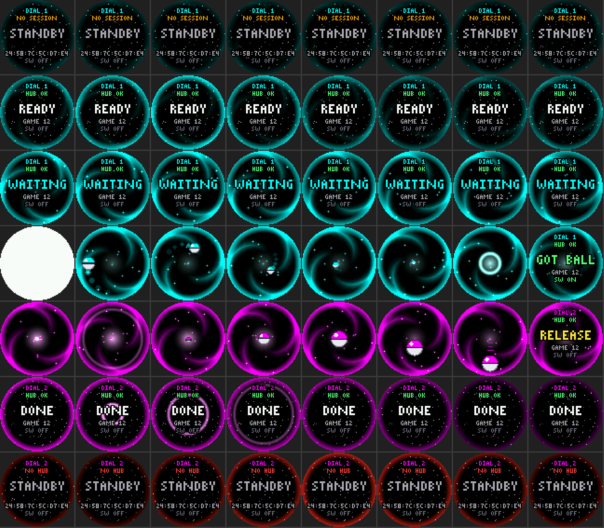

# ハードウェアと設定

設定は `config/` に置く。`*.example.h` をコピーして編集する（実ファイルは git 管理外）。

```
cp config/devices.example.h  config/devices.h    # 両システムの MAC とチャネル
cp config/hardware.example.h config/hardware.h   # ピン・角度・時間
python3 tests/tools/gen_secrets.py               # config/secrets.h（システムごとの PMK/LMK を乱数生成）
```

実ファイルがない場合はサンプルでビルドされ、機器は `example_keys` / `example_devices` を報告する（Hub の画面下部に赤帯（ATOM Lite の Hub では状態 LED が 5 秒ごとに赤）、`HELLO_ACK` / `DIAG` / ゲートウェイのログ警告）。
機器のファームウェアは `devices.h` / `secrets.h` がないとビルドエラーになる（サンプルの MAC・鍵では Hub と通信できないため）。コンパイル確認だけなら `PLATFORMIO_BUILD_FLAGS=-DUFO_ALLOW_EXAMPLE_CONFIG pio run`。別の PC で書き込む手順は [README](../README.md#別の-pc-でビルド書込みするとき必ずやること)。

## 共通

| 項目 | 設定 | 備考 |
|---|---|---|
| システム | `UFO_SYSTEM_ID`（PlatformIO env の `_s1` / `_s2`） | 同じ会場の 2 システムを区別する。[multi-system.md](multi-system.md) |
| Wi-Fi チャネル | `UFO_S1_WIFI_CHANNEL` / `UFO_S2_WIFI_CHANNEL`（`devices.h`） | **同じシステムの全機器で同じ値**。システム間は 5 ch 以上離す（既定 1 / 11）。AP には接続しない |
| MAC | `UFO_S1_MAC_*` / `UFO_S2_MAC_*`（`devices.h`） | 各ファームは起動時にシリアルへ `UFO system=N ... MAC=..` を出す（Hub は `BOOT` 行の `hub_mac`） |
| 鍵 | `UFO_S1_PMK`, `UFO_S1_LMK_*` / `UFO_S2_*`（`secrets.h`） | システムごとに別の鍵にする。鍵を変えたら、そのシステムの 4 台をすべて書き直す |

`devices.example.h` のシステム 1 の M5Dial の MAC は NeoGacha の `setGachaId()` にあった値（`C0:4E:30:12:6B:90` / `C0:4E:30:12:67:D4`）。同じ実機を使う場合にのみ有効で、それ以外はプレースホルダ。
旧形式（`UFO_WIFI_CHANNEL`, `UFO_MAC_*`, `UFO_PMK`, `UFO_LMK_*`）の設定はシステム 1 として読む。

## Hub（M5AtomS3R）

| 項目 | 値 |
|---|---|
| ボード | `m5stack-atoms3`（ESP32-S3、env `hub_s1` / `hub_s2`） |
| USB | ネイティブ USB CDC（`ARDUINO_USB_CDC_ON_BOOT=1`）。macOS では `/dev/cu.usbmodem*` |
| 画面 | 上部の帯にシステム番号（S1 = シアン、S2 = オレンジ）、チャネル、無線状態、PC セッション、子機ごとのオンライン状態。設定エラー・サンプル鍵は下部の赤帯 |

ATOM Lite を Hub にする場合は env `hub_atomlite_s1` / `hub_atomlite_s2`（USB-UART、状態 LED G27: 青 = PC 待ち、緑 = 全台オンライン、黄点滅 = 子機オフライン、赤点滅 = 無線停止）。

## Illumination ATOM（Device ID 0x10）

ATOM Lite + Atomic PWM Base + Unit 2Relay。旧 `atom_led_mist` スケッチの配線と演出をそのまま引き継ぐ。

| 項目 | 設定 | 初期値 | 備考 |
|---|---|---|---|
| WS2811 データ | `ILLUM_LED_PIN` | 21（ベースの「21」の穴） | |
| LED 数 / 種類 / 色順 | `ILLUM_LED_COUNT` / `ILLUM_LED_CHIPSET` / `ILLUM_LED_COLOR_ORDER` | 70 / WS2811 / GRB | 起動時に赤 → 緑 → 青と光れば、色順は正しい |
| LED 輝度上限 | `ILLUM_LED_MAX_BRIGHTNESS` | 200 | 電源容量に合わせて調整する |
| COB テープ PWM | `ILLUM_COB_PIN` | 22（Atomic PWM Base） | 10 kHz / 10 bit、2 乗カーブ。-1 で COB テープなし |
| COB 輝度上限 | `ILLUM_COB_MAX_BRIGHTNESS` | 255 | まぶしければ下げる |
| ミストリレー | `ILLUM_MIST_PIN` | 32（Unit 2Relay RELAY-2、Grove 黄） | -1 で無効（`SET_MIST` は `NOT_CONFIGURED`） |
| ミスト極性 | `ILLUM_MIST_ACTIVE_HIGH` | 1（HIGH = ON） | 逆に動く場合は 0 |
| ミスト 1 回の最大時間 | `ILLUM_MIST_MAX_S` | 600 s | 空焚き防止。超える要求は `clamped` |
| ミスト用ウォッチドッグ | `ILLUM_MIST_WATCHDOG_MS` | 1000 ms | `loop()` が止まったら強制 OFF |
| ボタン | `ILLUM_BUTTON_PIN` | 39 | -1 でローカル操作なし |
| ローカル操作 | `ILLUM_LOCAL_CONTROL` / `ILLUM_LOCAL_MIST` / `ILLUM_LOCAL_BRIGHTNESS` | 1 / 1 / 160 | |
| 蒸気リレー（短パルス用） | `ILLUM_RELAY_PINS` | `{-1}` = **未設定** | Unit 2Relay のもう一方（G26）を使える。設定するまで `RELAY_PULSE` は `NOT_CONFIGURED` |
| リレー極性 | `ILLUM_RELAY_ACTIVE_HIGH` | `{1}` | **未確認** |
| 最大 ON 時間 / 再噴射禁止 | `ILLUM_RELAY_MAX_ON_MS` / `ILLUM_RELAY_COOLDOWN_MS` | 3000 / 2000 ms | |
| セッション終了時の照明 | `ILLUM_SESSION_END_LIGHT_MODE` | 1 (IDLE) | |

### ミストの安全仕様

* 起動時: 出力レベルを「OFF」に書いてからピンを出力に切り替える（ON グリッチ防止）。
* 1 回の実行は最大 `ILLUM_MIST_MAX_S`（10 分）。時間が来たら自動で止まり、`MIST_DONE`（COMPLETED）を送る。
* PC 制御中は、Hub との通信断（3 秒）、セッション終了、`STOP_ALL`、`SET_MIST OFF` で即 OFF。通信断中は開始要求を受けない（`REJECTED_STATE`）。
* 本体ボタンの長押しで、いつでも止められる（PC 制御中も有効。`MIST_DONE` reason = LOCAL_BUTTON）。
* `esp_timer` によるウォッチドッグ: ミストが ON の間は `loop()` が 100 ms ごとにタイマを更新する。1 秒途絶えたら強制 OFF にし、`ERROR` イベント（RELAY_WATCHDOG, detail = 1）を送る。
* 蒸気リレー（`RELAY_PULSE`）とは別の出力で、別の規則で制御する。蒸気リレーは 1 回最大 3000 ms、クールダウンあり、`esp_timer` で最大 ON + 100 ms に強制 OFF。

### ローカル操作（PC のセッションがないとき）

| 操作 | 動作 |
|---|---|
| 短押し | 次のシーン（下表）。状態 LED が青く光る |
| 長押し（0.8 秒） | ミストの ON / OFF（緑 = ON、赤 = OFF）。OFF にすると、以後のシーンでも光だけになる |

| # | シーン | 照明モード | ミスト |
|---|---|---|---|
| 0 | off | OFF | なし |
| 1 | aurora mist | AURORA | 連続 |
| 2 | storm cloud | STORM | 連続 |
| 3 | campfire smoke | CAMPFIRE | 連続 |
| 4 | breathing mist | MIST_GLOW | BREATH |
| 5 | rainbow mist | GAME_PLAY | 連続 |
| 6 | magic puff | MAGIC_PUFF | PUFF |
| 7 | night | NIGHT | BREATH |

* ローカル操作は Hub がなくても動く（展示の単体運用・実機確認用）。ローカルのミストも最大 10 分で止まる。
* PC のセッションが始まるとローカル操作は終了する（ミスト OFF、照明は `ILLUM_SESSION_END_LIGHT_MODE`）。セッション中の短押しは無視する（状態 LED が紫に光る）。

## M5Dial ×2（Device ID 0x20 / 0x21）

NeoGacha `src/M5Dial_Gacha` から確認した値をそのまま初期値にしている。

| 項目 | 設定 | 初期値 | 根拠 |
|---|---|---|---|
| SG90 信号 | `DIAL_SERVO_PIN` | 13 | `#define SERVO_PIN 13` |
| PWM | `DIAL_SERVO_PERIOD_HZ` | 50 | `setPeriodHertz(50)` |
| パルス幅 | `DIAL_SERVO_MIN_US/MAX_US` | 500 / 2400 | `minUs/maxUs` |
| 待機角度 | `DIAL_SERVO_STANDBY_DEG` | 180 | MODE_STOP の `pos[0]=180`、MODE_B の復帰 `write(180)` |
| 排出角度 | `DIAL_SERVO_RELEASE_DEG` | 0 | MODE_B `if (spentTime <= 1500) servo1.write(0)` |
| 保持時間 | `DIAL_SERVO_HOLD_MS` | 1500 | 同上 |
| 復帰整定 | `DIAL_SERVO_RETURN_SETTLE_MS` | 600 | **未確認**（新規。復帰完了までの待ち） |
| 通信断時の排出中動作 | `DIAL_LINK_LOSS_ABORT_RELEASE` | 0（シーケンスを最後まで実行して待機位置へ） | 1 で即待機位置へ |
| サーボの速度 | `DIAL_SERVO_SLEW_DEG_PER_S` | 240（180° を 0.75 秒） | 電源対策。0 = 一気に動かす（NeoGacha と同じ） |
| 停止後のパルス停止 | `DIAL_SERVO_DETACH_MS` | 500 | 電源対策。待機位置に戻ってこの時間後にパルスを止める。0 = 保持し続ける |
| 起動時のサーボ待ち | `DIAL_SERVO_BOOT_DELAY_MS` | 1000 | 電源対策。無線の起動が済んでから待機位置へ動かす |
| 受取スイッチ GPIO | `DIAL_RECEIVER_PIN` | 2（PORT.B、LED の隣のピン） | スイッチ ON = ボール投入 |
| 受取スイッチ極性 | `DIAL_RECEIVER_ACTIVE_LOW`, `DIAL_RECEIVER_PULLUP` | 1, 1（スイッチで GND に落とす、内部プルアップ） | 3.3V 側に繋いだ場合は 0, 0 |
| デバウンス | `DIAL_RECEIVER_DEBOUNCE_MS` | 30 | |
| 模擬ボタン | `DIAL_RECEIVER_SIM_BUTTON` | 0 | 1 にすると BtnA = 受取スイッチ ON（開発用。設定モードは使えなくなる） |
| 前面 LED | `DIAL_LED_PIN`, `DIAL_LED_COUNT`, `DIAL_LED_BRIGHTNESS` | 1, 26, 25 | NeoGacha `LED_PIN2=1`, `NUM_LEDS 26`, `setbrightness(25)` |
| サーボ動作中の LED | `DIAL_LED_BRIGHTNESS_SERVO` | 6 | 電源対策。サーボが動いている間は LED を暗くする |
| 設定モード | `DIAL_SETTINGS_HOLD_MS`, `DIAL_SETTINGS_TIMEOUT_S` | 2000, 300 | ボタン長押し時間 / 無操作で自動終了 |
| メニュー | `DIAL_MENU_TIMEOUT_S` | 10 | 無操作でメニューを閉じるまでの秒数（0 = 閉じない） |
| エンコーダ | `DIAL_ENCODER_COUNTS_PER_STEP` | 4 | 1 クリックで項目が 1 つ進まない場合に調整 |
| 号機色 | `DIAL_UNIT_COLOR_1`, `DIAL_UNIT_COLOR_2` | `{0,255,255}`（シアン）, `{255,0,255}`（マゼンタ） | 初期提案色。PC の `SET_DIAL_COLOR` でセッション中だけ変更できる |
| 受取時のローカル発光 | `DIAL_RX_FLASH_MS`, `DIAL_RX_CHASE_MS` | 150, 1500 | **未確認**（提案値）。白フラッシュ → 号機色が画面方向へ |
| LED の並び | `DIAL_LED_FOLDED`, `DIAL_LED_REVERSED` | 1, 0 | NeoGacha `level2()` のとおり、前半の画素は下から上へ、後半は上から下へ並ぶ 2 列。REVERSED は **未確認**（画面側が下なら 1） |
| 2 本目の LED | `DIAL_TRANSFER_LED_PIN`, `DIAL_TRANSFER_LED_COUNT` | 15, 26 | NeoGacha `LED_PIN1 15`（topLed）。**LED 数は未確認**（NeoGacha の `NUM_LEDS` を仮置き）。-1 で使わない |
| 2 本目の並び・種類・輝度 | `DIAL_TRANSFER_LED_FOLDED`, `_REVERSED`, `_CHIPSET`, `_COLOR_ORDER`, `_BRIGHTNESS` | 1, 0, WS2812B, GRB, 25 | **未確認** |
| 2 本目の電源 | `DIAL_TRANSFER_LED_SEPARATE_POWER` | 0 | 0 = M5Dial 給電（サーボ動作中は減光）。別電源にしたら 1 |

NeoGacha との違い:

* NeoGacha の MODE_STOP / MODE_A はダイヤル回転のたびに 180°/160° を往復していた（攪拌動作）。本システムでは PC の `RELEASE_BALL` 以外でサーボを動かさないため移植していない。
* 起動時は無線の起動から `DIAL_SERVO_BOOT_DELAY_MS` 後に待機角度 180° を出力する。電源投入時にホーンが待機位置へ動く。
* サーボはゆっくり動かし、待機位置で止まったらパルスを止める（下記の電源対策）。

### サーボの電源対策

SG90 は動き始めと引っかかったときに最大 0.7 A ほど流れ、M5Dial の電源が落ちる（再起動する）ことがある。ファームウェアでは次の対策をしている。

1. **ゆっくり動かす**: 180° を一気に動かさず、`DIAL_SERVO_SLEW_DEG_PER_S`（既定 240°/秒）で少しずつ角度を変える。保持時間・整定時間は移動が終わってから数える。
2. **止まったらパルスを止める**: 待機位置に戻って `DIAL_SERVO_DETACH_MS` 後にパルスを止める。保持電流と細かい振動がなくなる。次の動作で自動的に再開する。
3. **ほかの負荷と重ねない**: サーボが動いている間は LED を `DIAL_LED_BRIGHTNESS_SERVO` まで暗くし、スピーカーを鳴らさない。
4. **起動時に重ねない**: 無線の起動が終わってから `DIAL_SERVO_BOOT_DELAY_MS` 後にサーボを動かす。

それでも落ちる場合は配線側で対策する:

* サーボの電源（赤・茶）の根元に **470〜1000 µF の電解コンデンサ**を入れる。
* サーボを M5Dial の 5V ではなく**別の 5V 電源**から給電し、GND だけ M5Dial と共通にする。
* USB 給電の場合は、2 A 以上の電源アダプタとしっかりしたケーブルを使う。

パルスを止めた状態では、ホーンはギアの摩擦だけで止まっている。待機位置でゲートが押し戻されてボールが漏れる場合は `DIAL_SERVO_DETACH_MS 0` にする（保持し続ける）。

### メニュー（ダイヤルを回す）

設定モード以外のとき、**ダイヤルを回す**とメニューが出る。回して項目を選び、**押す**と実行する。最初は `CLOSE` の位置で開くので、ダイヤルに触れただけで何かが実行されることはない。10 秒（`DIAL_MENU_TIMEOUT_S`）操作しないと閉じる。

| 項目 | 動作 |
|---|---|
| `CLOSE` | メニューを閉じる |
| `DIAL RESET` | この Dial を再起動する。サーボが動いている間は実行しない（`SERVO RUNNING`） |
| `POWER OFF` | この Dial の電源を切る。**バッテリー駆動のときだけ本当に切れる。** USB / 5 V 給電では電源を切れないので、画面と LED を消してスリープに入る。復帰は背面のリセットボタンか、電源の入れ直し |
| `RELEASE` | 排出シーケンス（排出角度 → 保持 → 待機位置）を 1 回動かす。ゲームの状態は変えず、PC へのイベントも送らない（詰まったカプセルを手で出すための操作） |
| `GAME RESTART` | ゲームにリスタートを依頼する（`DIAL_REQUEST` イベント） |
| `GAME END` | ゲームに終了を依頼する（`DIAL_REQUEST` イベント） |

* 実行結果は画面に約 1.5 秒出て、メニューが閉じる（`SENT` = 送信した、`NO GAME` = Hub かセッションがなく送っていない、`RELEASING`、`SERVO RUNNING`）。
* `GAME RESTART` / `GAME END` は**依頼を送るだけ**で、実際にどうするかはゲーム側が決める（[game-mode-interface.md](game-mode-interface.md) 2.7）。ゲームが `DIAL_REQUEST` に対応していなければ何も起きない。
* メニューを開いていても受取スイッチ・PC からの命令・LED 演出は止まらない。
* メニューを開いたまま 2 秒長押しすると設定モードに入る。`DIAL_RECEIVER_SIM_BUTTON 1`（ボタンが模擬スイッチ）のときはメニューは出ない。

### 設定モード（ハードウェアテスト）

ゲームのサイクル中（`WAITING` / `GOT BALL` / 排出中）以外のとき、**本体ボタンを 2 秒長押し**すると設定モードに入る（画面が紺色）。

| 操作 | 動作 |
|---|---|
| ダイヤルを回す | 項目を選ぶ |
| 押す | 選んだ項目を実行 |
| 2 秒長押し / `EXIT` | 設定モードを終わる（サーボは待機位置へ） |

| 項目 | 内容 |
|---|---|
| `SERVO TEST` | 排出シーケンス（排出角度 → 保持 → 待機位置）を 1 回動かす |
| `SERVO ANGLE` | 押すと調整開始。ダイヤル 1 クリックで 5° 動く。もう一度押すと待機位置へ戻る |
| `LED TEST` | 押すたびに 赤 → 緑 → 青 → 白 → 虹 → 流れる → 消灯 |
| `SWITCH TEST` | スイッチの状態と ON 回数を表示し、ON のたびに音が鳴る。押すと回数を 0 に戻す |

* 画面下には、どの項目でもスイッチの状態（`switch G2 ON/off xN`）とサーボ角度を表示する。
* 設定モード中は PC への `BALL_RECEIVED` などのイベントを送らず、PC からの命令は `STOP_ALL` 以外すべて `REJECTED_STATE` になる。PC には状態 `SETTINGS` が見える。
* PC の `STOP_ALL` で設定モードは終わる。操作がないまま `DIAL_SETTINGS_TIMEOUT_S`（5 分）たっても終わる。

**サーボの回転方向・角度・保持時間は実機の排出機構で確認するまで変更しないこと。** 確認手順は `docs/test-plan.md` 3.2。

### 表示

通常画面はドット絵のアニメーション（80 × 80 ドットを 3 倍に拡大、最大 20 コマ/秒）。丸い画面そのものを、実機と画面ゲームをつなぐ**ポータル**に見立てている。色は号機色（1 号機シアン、2 号機マゼンタ。`SET_DIAL_COLOR` に追従）。

| 状態 | 画面 |
|---|---|
| `STANDBY` | 星空と淡いリング。セッションがない間は自 MAC を表示（セットアップ用） |
| `READY` | リングがゆっくり明滅 |
| `WAITING`（受取待ち） | 渦が回り、光の粒が中心へ吸い込まれる |
| `GOT BALL`（受取済み） | 白フラッシュ → **カプセルが下（実機側）から渦を巻いてポータルへ吸い込まれる**（1.2 秒）→ 中心からリングが広がる → 中心が脈動 |
| `RELEASE` / `RETURN`（排出中） | リングが広がる → **カプセルがポータルから出てきて大きくなり、下へ落ちて画面の外へ出る**（2 秒）→ 外向きの渦 |
| `DONE` | リングが広がって消え、星がまたたく |
| `ERROR` / Hub 通信断 | 赤（`NO HUB`、`RADIO ERR`、`ERROR n`） |

文字: `DIAL n` / Hub 接続（`HUB OK`, `NO SESSION`, `NO HUB`, `RADIO ERR`）/ 状態 / `GAME <サイクル>` / 警告（`MAC MISMATCH`, `ERROR n`, `EXAMPLE KEYS`）/ スイッチ（`SW ON` / `SW OFF`、模擬ボタンのときは `SIM`）。カプセルのアニメーション中は文字を出さない。



上から STANDBY / READY / WAITING / GOT BALL / RELEASE / DONE / 通信断（左から右へ時間が進む）。この画像は実機ではなく、同じ描画コード（`firmware/m5dial/dial_scene.cpp`）を PC で動かして作ったもの: `tests/tools/scene_preview/run.sh 出力先フォルダ`。絵を変えるときは、まずこれで確認できる。アニメーションの時間は `dial_scene.h` の `kScene*Ms`。メニューと設定モードは従来どおりの文字画面。

### LED（G1 の前面 LED と G15 の LED、ゲームモード）

契約（演出 ID・優先順位・同期点・LED の並びと向き・Illumination 流用の検討）は [game-mode-interface.md](game-mode-interface.md)。

| 状態 | 前面 LED（G1）の表示（PC 演出がないとき） |
|---|---|
| DISABLED | pacifica（NeoGacha MODE_STOP） |
| READY | 白のゆっくり呼吸 |
| ARMED | 号機色のチェイス |
| BALL_DETECTED | 白フラッシュ → 号機色が画面方向へ流れる → 号機色の呼吸 |
| RELEASING / RETURNING | 号機色が実機方向へ流れる |
| COMPLETE | フェードアウト（NeoGacha `fade()`） |
| Hub 通信断 | 赤の呼吸 |

* PC は `SET_DIAL_EFFECT` で 2 系統の LED に演出を出せる。G15 の LED は、受取・排出のアニメーションと PC 演出のときだけ光る（それ以外は消灯）。ボール検出、排出終了、`STOP_ALL`、セッション終了、通信断で Dial が自分で止める。
* G15 の LED は NeoGacha では点灯させていなかった。2 系統を同時に光らせたときの電流は**未確認**（サーボ動作中は 2 系統とも減光する）。
* サーボ動作中は PC 演出も `DIAL_LED_BRIGHTNESS_SERVO` まで暗くなる（電源対策を優先）。

## スタッフ用リモコン（M5StopWatch、Device ID 0x30）

展示のスタッフが、ゲーム（CoreXY_UFO_Game）の画面のボタンやキーボードを使わずに操作するための手元の端末。
**リモコンは押されたことを送るだけで、どうするかはゲームが決める**（STAFF_ACTION / REMOTE_INPUT、[protocol.md](protocol.md)）。
ゲーム側の受け取り方はゲームの `docs/staff_operations.md`。

| 項目 | 内容 |
|---|---|
| 本体 | M5Stack StopWatch（ESP32-S3R8、16 MB Flash、8 MB PSRAM、1.75 インチ 466×466 円形 AMOLED、タッチ CST820、BMI270、振動モーター） |
| ボタン | 黄 = KEYA（G2、M5Unified の BtnA）、青 = KEYB（G1、BtnB）、電源ボタン（1 回 = 電源オン / リセット、2 回 = 電源オフ） |
| ビルド | `pio run -e staff_remote_s2 -t upload`（システム 1 は `_s1`。`default_envs` には入れていない） |
| 設定 | MAC: `config/devices.h` の `UFO_Sn_MAC_STAFF_REMOTE`（起動ログの `MAC=`、USB のシリアル番号と同じ）。鍵: `config/secrets.h` の `UFO_Sn_LMK_STAFF_REMOTE`（`python3 tests/tools/gen_secrets.py` が足りない鍵だけ足す）。**リモコンを足したら Hub も書き直す**（Hub が知っている機器の表に入る） |

### 画面と操作

円形の画面に 5 つの区画の輪と中央。青ボタンで 2 つの画面を切り替える。いちばん外側の細い輪が接続状態（緑 = ゲームとつながっている、橙 = Hub だけ、赤 = Hub もない）。中央の上の行に画面名・システム番号・電池残量。

**タッチはすべて長押しで送る**: 押している間、区画が内側から満ちていき、満ちたら短く振動して送る。途中で離す・指が区画の外へずれると何も送らない（区画の間の隙間も反応しない）。

| 画面 | 操作 | 長押し | 送るもの |
|---|---|---|---|
| スタッフ | 輪: つぎへ / とばす / メニュー / きりかえ | 0.45 秒 | STAFF_ACTION NEXT / SKIP / MENU / SWITCH |
| | 輪: ふっき（アームが動く） | 1.2 秒 | STAFF_ACTION RECOVER |
| | 中央: ストップ | 0.25 秒 | STAFF_ACTION STOP |
| | 黄ボタン | — | STAFF_ACTION NEXT |
| そうさ | 黄ボタンを押しながら傾ける（押した瞬間の傾きが中心。離すと止まる。中央の点が傾きを表す） | — | REMOTE_INPUT move + x/y |
| | 輪: じょうげ（オン / オフ）。オンで黄ボタン + 前後（奥 = アームを上げる） | 0.45 秒 | REMOTE_INPUT move + z |
| | 輪: つかむ / はなす / ポータル（1.2 秒その形を見せてから 0.4 秒パー） | 0.45 秒 | REMOTE_INPUT pose FIST / PEACE / POINT |
| | 輪: ストップ | 0.25 秒 | STAFF_ACTION STOP |

* 送れなかったとき（Hub や PC とつながっていない）は中央の下の行に赤で出て、長く振動する。
* 60 秒（`REMOTE_DIM_S`）操作がないと画面を暗くする。暗いときの最初のタッチ・ボタンは画面を戻すだけで、何も送らない。
* ストップ、Hub の STOP_ALL、セッションの変化、Hub との通信断で入力の送信をやめ、黄ボタンを一度離すまで再開しない。
* 画面の確認: USB でつないで `uv run --no-project --with pyserial --with pillow python tests/tools/remote_screenshot.py <ポート> out.png`（シリアルの `S` で画面を送る。`P` は画面の切り替え、デバッグ用）。

### 調整（`config/hardware.h`、なければ既定値）

| 名前 | 既定 | 意味 |
|---|---|---|
| `REMOTE_TILT_DEAD_DEG` / `REMOTE_TILT_FULL_DEG` | 4 / 25 | 傾きの不感帯と、最高速になる傾き（度） |
| `REMOTE_TILT_SWAP_XY` / `REMOTE_TILT_INVERT_X` / `REMOTE_TILT_INVERT_Y` | 1 / 0 / 1（StopWatch の IMU は画面に対して 90° 回り、前後が逆。2026-11-22 に実機で確認） | 傾きの軸の入れ替え・反転（画面の十字の点が、傾けた方向に動くように合わせる） |
| `REMOTE_HOLD_MS` / `REMOTE_STOP_HOLD_MS` / `REMOTE_RECOVER_HOLD_MS` | 450 / 250 / 1200 | 長押しの時間（ふつう / ストップ / ふっき） |
| `REMOTE_BRIGHTNESS` / `REMOTE_DIM_S` / `REMOTE_VIBRATION` | 160 / 60 / 160 | 画面の明るさ、暗くするまでの秒数、振動の強さ（0 = 振動しない） |

## 照明モード・演出（Illumination）

| モード | WS2811 | COB |
|---|---|---|
| OFF | 消灯 | 消灯 |
| IDLE | pacifica | ゆっくり明暗 |
| STUDY | 暖色の呼吸 | 明るめで一定（デスクライト） |
| GAME_READY | シアンのチェイス | 暗め |
| GAME_PLAY | レインボー（speed で速度） | 暖色の下地 |
| RESULT | ゴールドのきらめき | やや明るい |
| ERROR | 赤点滅 1 Hz | 消灯 |
| CUSTOM | `color`。speed=0 で点灯、>0 で呼吸 | `brightness` |
| AURORA | 青緑〜紫が流れる | ゆったり明暗 |
| STORM | 雷雲 + 稲妻 | 普段はほのか、稲妻で明るく |
| CAMPFIRE | 炎（Fire2012） | ロウソクのゆらぎ |
| MIST_GLOW | ミストが出ている間は明るく、止まると暗く | ミストと連動 |
| MAGIC_PUFF | ミストが出ている間はキラキラ | ミストと連動 |
| NIGHT | 消灯 | ゆっくり呼吸 |

MIST_GLOW / MAGIC_PUFF はミストの出力に連動するので、`SET_MIST` と組み合わせて使う。
`transition_ms` を指定すると、モード切替時に WS2811 と COB の両方がクロスフェードする。演出（既定時間）: GAME_START 1500, ARM_MOVE 600, ARM_DESCEND 1200, CATCH 800, BALL_RECEIVED 1000, BALL_RELEASED 1000, SCORE 1500, GAME_CLEAR 4000, GAME_OVER 2500 ms（最大 10000 ms）。
演出中、COB は GAME_START で明るくなっていき、CATCH で点滅、SCORE / GAME_CLEAR で全灯、GAME_OVER でフェードアウトする。
